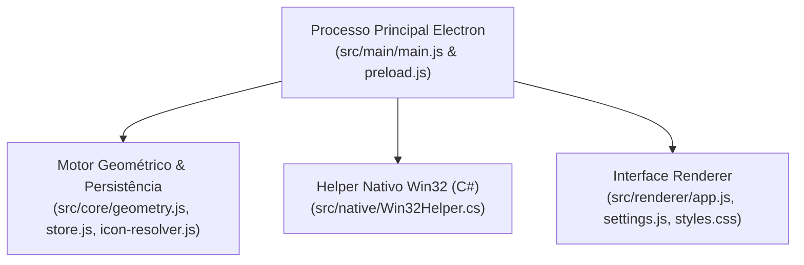

# Drawer — Organizador de Ícones Estilo Gavetas para Windows

<p align="center">
  
</p>


**Autor:** Renan Santa Rosa Xavier

---

## Visão Geral

O **Drawer** é um organizador de ícones para a Área de Trabalho do Windows baseado em **Gavetas (*Drawers*)**, inspirado nas pastas de servidores do **Discord**. Ele substitui a desordem de atalhos soltos por gavetas azuis arredondadas com prévia `2×2` que se expandem suavemente ao passar o mouse ou clicar.


---

## Principais Recursos

- **Gavetas Azuis de Pontas Arredondadas:** Visual moderno em azul com prévia interna `2×2` em tempo real dos ícones armazenados.
- **Abertura Contínua com Autoajuste Geométrico:** Ao abrir, expande lateralmente (ou para baixo) como um painel arredondado conectado à gaveta, ajustando automaticamente a grade (`1×1`, `2×1`, `3×1`, `4×1`, `4×2`, etc.) à quantidade de atalhos.
- **Direção Inteligente de Abertura:** Detecta as bordas do monitor e abre automaticamente para a **direita**, **baixo** ou **esquerda**.
- **Interação Hover + Clique (Pin):**
  - **Passar o mouse (*Hover*):** Abre com animação suave (`260ms cubic-bezier`) e permanece aberta por **1,25s** (`1250ms`) após retirar o cursor.
  - **1º Clique:** Fixa (*Pin*) a gaveta aberta permanentemente.
  - **2º Clique:** Desafixa e recolhe a gaveta.
- **Integração Nativa Win32 (`Win32Helper.cs`):** Permanece ancorado no nível da Área de Trabalho do Windows (mesmo ao pressionar `Win + D` / *Mostrar Área de Trabalho*) e extrai ícones reais em alta resolução de arquivos `.exe`, `.lnk` e jogos da Steam (`.url`).
- **Drag & Drop Bidirecional:** Arraste atalhos da Área de Trabalho para dentro da gaveta ou arraste-os de volta para o Desktop.

---

## Arquitetura do Projeto



---

## Como Executar e Gerar o Instalador

```bash
# Instalar dependências
npm install

# Executar a suíte de testes automatizados
npm test

# Iniciar o aplicativo em modo de desenvolvimento
npm start

# Compilar o helper nativo Win32 e gerar o instalador Windows (.exe NSIS) em dist/
npm run dist
```
