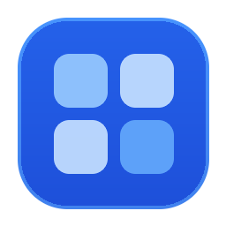
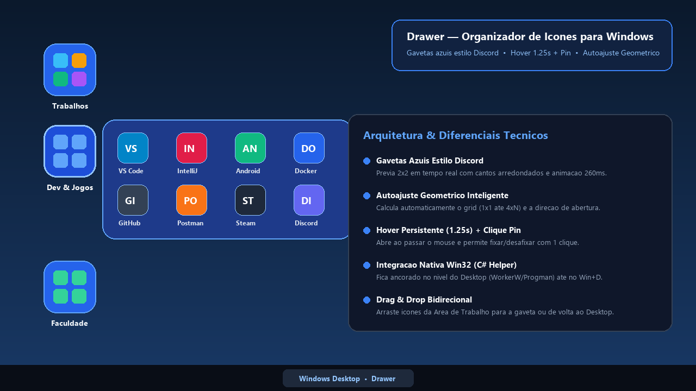
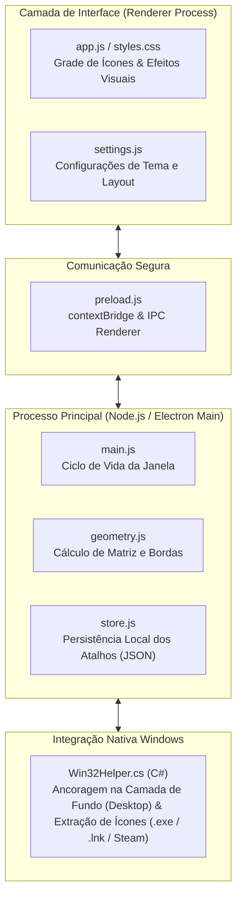

# Drawer — Organizador de Ícones Estilo Gavetas para Windows

<p align="center">
  
</p>


[](https://renan-xavier.vercel.app)

**Autor:** Renan Santa Rosa Xavier | 🌐 **Portfólio:** [renan-xavier.vercel.app](https://renan-xavier.vercel.app)

---

## 📌 Visão Geral

O **Drawer** é um aplicativo desktop para Windows que organiza a Área de Trabalho em **Gavetas inteligentes**, inspirado no sistema de pastas do **Discord**.

Em vez de dezenas de ícones espalhados pela tela, o Drawer agrupa atalhos em gavetas arredondadas compactas. Ao passar o mouse ou clicar, a gaveta expande suavemente um painel com autoajuste geométrico (`1×1`, `2×1`, `3×1`, `4×2`), mantendo os ícones organizados e acessíveis.

---

## 🎬 Demonstração do Sistema

Prévia real do aplicativo em funcionamento na Área de Trabalho do Windows:



### Principais Funcionalidades:
* **Autoajuste Geométrico:** Calcula as dimensões ideais da grade conforme o número de atalhos adicionados.
* **Detecção Inteligente de Bordas:** Identifica a posição do monitor e define automaticamente a direção de abertura (direita, baixo ou esquerda) para evitar que o painel saia da tela.
* **Controle por Hover e Pin:**
  * *Hover:* Abre com transição suave (`260ms cubic-bezier`) e fecha após `1,25s` de inatividade.
  * *Clique único:* Trava (*Pin*) a gaveta aberta para consultas prolongadas.
  * *Segundo clique:* Desafixa e recolhe a gaveta.
* **Drag & Drop Nativo:** Suporte a arrastar e soltar atalhos diretamente da Área de Trabalho para a gaveta e vice-versa.

---

## 🏛️ Arquitetura da Solução

O projeto combina a interface reativa do Electron com um helper nativo compilado em C# para acessar recursos de baixo nível da shell do Windows:



---

## 🛠️ Tecnologias Utilizadas

| Tecnologia | Papel no Projeto |
| :--- | :--- |
| **Electron 35** | Framework para construção de aplicações desktop multiplataforma usando tecnologias web. |
| **Node.js** | Execução de rotinas do processo principal, leitura do sistema de arquivos e gerenciamento de processos. |
| **C# (.NET / Win32)** | Helper compilado para invocar a API Win32 (`User32.dll`, `Shell32.dll`), garantindo que o app permaneça fixado ao nível do papel de parede (mesmo com `Win + D`) e extraindo ícones em alta resolução. |
| **CSS3 Moderno** | Animações fluidas com curvas `cubic-bezier`, cantos arredondados e suporte a temas. |
| **NSIS** | Criação do instalador executável (.exe) empacotado para distribuição no Windows. |

---

## 🚀 Como Executar Localmente

### Pré-requisitos
* **Node.js 18+** e npm instalados.
* Sistema operacional **Windows 10 ou 11**.

### Comandos:
```bash
# 1. Instalar as dependências do projeto
npm install

# 2. Executar a suíte de testes automatizados
npm test

# 3. Iniciar o aplicativo em modo de desenvolvimento
npm start

# 4. Compilar o helper nativo e gerar o instalador (.exe) na pasta dist/
npm run dist
```
