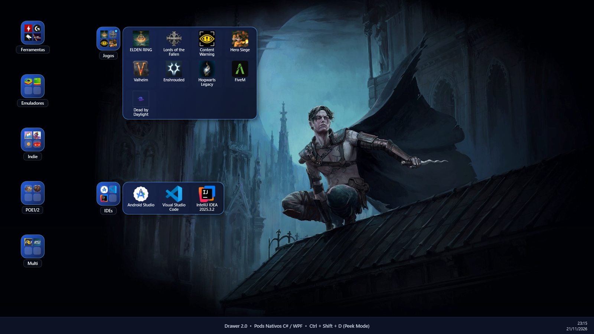
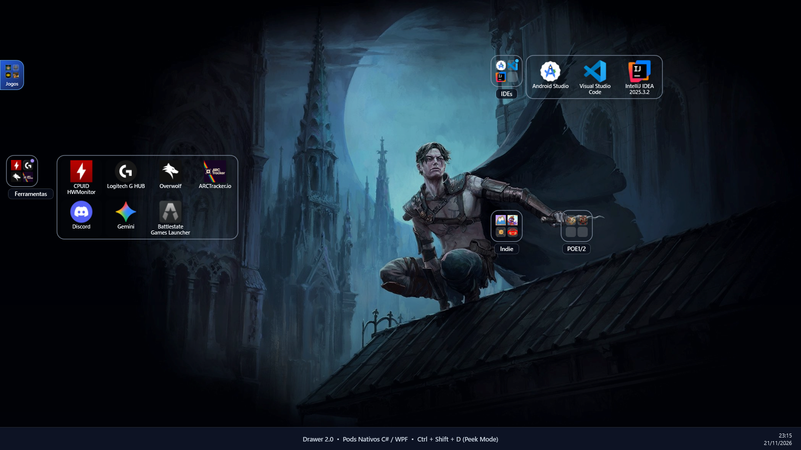
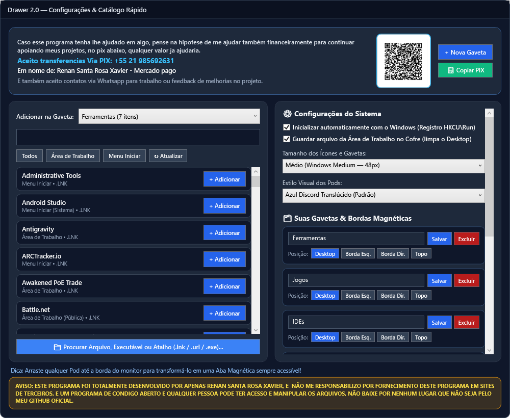
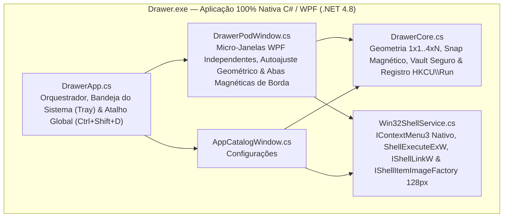

# Drawer 2.0 — Pods Nativos & Bordas Magnéticas para Windows

<p align="center">
  
</p>


[](https://renan-xavier.vercel.app)

**Autor:** Renan Santa Rosa Xavier | 🌐 **Portfólio:** [renan-xavier.vercel.app](https://renan-xavier.vercel.app)

> [!CAUTION]
> **AVISO: ESTE PROGRAMA FOI TOTALMENTE DESENVOLVIDO POR APENAS RENAN SANTA ROSA XAVIER, E NÃO ME RESPONSABILIZO POR FORNECIMENTO DESTE PROGRAMA EM SITES DE TERCEIROS, É UM PROGRAMA DE CÓDIGO ABERTO E QUALQUER PESSOA PODE TER ACESSO E MANIPULAR OS ARQUIVOS, NÃO BAIXE POR NENHUM LUGAR QUE NÃO SEJA PELO MEU GITHUB OFICIAL.**

---

## 💚 Apoie o Projeto & Contato (PIX / WhatsApp)

Caso esse programa tenha lhe ajudado em algo, pense na hipótese de me ajudar também financeiramente para continuar apoiando meus projetos, no PIX abaixo, qualquer valor já ajudaria:

* **Aceito transferências Via PIX:** `+55 21 985692631`
* **Em nome de:** `Renan Santa Rosa Xavier - Mercado pago`
* **Contato:** E também aceito contatos via **WhatsApp (`+55 21 985692631`)** para trabalho ou feedback de melhorias no projeto.

<p align="center">
  
</p>

---

## 📥 Download & Instalação Oficial (Para Windows 10 e Windows 11)

> 💻 **Sistema Operacional Compatível:** Exclusivo para **Microsoft Windows (Windows 10 e Windows 11 — 64 bits)**.

Clique no botão ou nos links oficiais abaixo para baixar o instalador `.exe` diretamente do GitHub Oficial:

<p align="center">
  <a href="https://github.com/Renan-Xavier/Drawer-Windows-Organizer/releases/download/v2.0.0/Drawer-Setup-2.0.0.exe">
    
  </a>
</p>

* 📦 **Opção 1 — Instalador Oficial para Windows (Recomendado):** [**Clique aqui para baixar `Drawer-Setup-2.0.0.exe`**](https://github.com/Renan-Xavier/Drawer-Windows-Organizer/releases/download/v2.0.0/Drawer-Setup-2.0.0.exe)
  *(Instala automaticamente no Windows, cria os atalhos na Área de Trabalho/Menu Iniciar e configura a inicialização automática com o Windows).*
* ⚡ **Opção 2 — Executável Portátil para Windows:** [**Clique aqui para baixar `Drawer.exe`**](https://github.com/Renan-Xavier/Drawer-Windows-Organizer/releases/download/v2.0.0/Drawer.exe)
* 🔗 **Página Oficial de Releases no GitHub:** [github.com/Renan-Xavier/Drawer-Windows-Organizer/releases/tag/v2.0.0](https://github.com/Renan-Xavier/Drawer-Windows-Organizer/releases/tag/v2.0.0)

---

## 📌 Visão Geral

O **Drawer 2.0** é um organizador nativo para Windows que agrupa programas, jogos e atalhos em **Gavetas inteligentes (Pods Nativos)** inspiradas no sistema de pastas do **Discord**.

Diferente de sobreposições de tela cheia tradicionais, cada gaveta no **Drawer 2.0** é uma **micro-janela nativa independente em C# / WPF acelerada por DirectX** (`WindowStyle.None`, zero barra superior, 0% de uso de CPU em repouso), integrada diretamente às APIs COM da Shell do Windows (`IContextMenu3`, `IShellLinkW`, `IShellItemImageFactory` e `ShellExecuteExW`).

---

## 📸 Capturas de Tela (Drawer 2.0 em Ação)

### 1. Pods Nativos na Área de Trabalho (Gavetas Fechadas e Abertas — Estilo Azul Discord)
<p align="center">
  
</p>

### 2. Encaixe Magnético nas Bordas (*Edge-Docked Tabs*) & Modo Transparente / Glass
<p align="center">
  
</p>

### 3. Configurações do Sistema & Catálogo Rápido de Aplicativos
<p align="center">
  
</p>

---

## ✨ Principais Inovações da Versão 2.0

* **Pods Nativos Independentes (Zero Sobreposição de Tela Cheia):** Cada gaveta ocupa apenas seus próprios pixels na tela — sem janela invisível cobrindo o monitor, sem barra superior fantasma e sem loops de *hit-test*.
* **Encaixe Magnético nas Bordas (*Edge-Docked Tabs*):**
  * No centro da tela, o Pod vive na camada da Área de Trabalho (não cobre suas janelas abertas).
  * Ao arrastar um Pod até qualquer borda do monitor (**Esquerda**, **Direita** ou **Superior**), ele se acopla magneticamente como uma **Aba Retrátil estilo Discord** sempre acessível — basta encostar o mouse na borda da tela para abrir a gaveta por cima de qualquer jogo ou navegador maximizado.
* **Atalho Global de Chamada Rápida (`Ctrl + Shift + D` — *Peek Mode*):** Traz todas as suas gavetas instantaneamente para a frente da janela atual para abrir qualquer programa sem precisar minimizar nada.
* **Menu de Botão Direito 100% Nativo do Windows (`IContextMenu`):** Clicar com o botão direito em qualquer ícone dentro da gaveta abre o **menu real do Windows Explorer** daquele programa (*Abrir*, *Executar como administrador*, *Abrir local do arquivo*, *Propriedades*, etc.) integrado às ações da gaveta (*Renomear*, *Devolver para a Área de Trabalho*).
* **Execução 100% Fiel de Qualquer Atalho ou Programa (`.lnk`, `.url`, `.exe`, Pastas):** Preserva argumentos de inicialização (como Discord/Spotify `Update.exe --processStart`), diretório de trabalho (`WorkingDirectory`) e protocolos de jogos (`steam://rungameid/...`).
* **Catálogo Rápido de Aplicativos (1 Clique):** Escaneia automaticamente todos os atalhos da **Área de Trabalho** e programas instalados no **Menu Iniciar** com busca em tempo real para adicionar às gavetas sem precisar procurar executáveis em pastas ocultas.
* **Inicialização Real com o Windows:** Registro direto e validado em `HKCU\Software\Microsoft\Windows\CurrentVersion\Run`.

---

## 🛡️ Configurações Automáticas do Windows (Pronto para Qualquer Usuário)

O **Drawer 2.0** e seu instalador (`Drawer-Setup-2.0.0.exe`) já aplicam automaticamente todas as configurações necessárias no Windows de qualquer usuário sem precisar de nenhuma configuração manual:

1. **Sincronização Automática de Token com o Windows Explorer (`TryRelaunchUnelevatedViaExplorer`):** Caso o programa ou instalador seja aberto como Administrador, ele sincroniza automaticamente seu nível de integridade (*Medium Integrity*) com o `explorer.exe` e habilita `ChangeWindowMessageFilterEx` (`WM_DROPFILES`, `WM_COPYDATA`, `WM_COPYGLOBALDATA`), garantindo que arrastar ícones da Área de Trabalho para dentro e para fora das gavetas funcione imediatamente sem bloqueio de UIPI do Windows.
2. **Proteção Automática contra o Botão "Mostrar Área de Trabalho" (`DWMWA_EXCLUDED_FROM_PEEK`):** Todas as gavetas aplicam automaticamente os atributos nativos do Desktop Window Manager (`DWMWA_EXCLUDED_FROM_PEEK = 12`, `DWMWA_DISALLOW_PEEK = 11` e detector de elevação do `WorkerW`), permanecendo visíveis quando o usuário clica em *Mostrar Área de Trabalho* (`Win + D`) e ficando atrás de todas as janelas normais de programas.
3. **Instalação Persistente & Inicialização Automática com o Windows (`HKCU\Software\Microsoft\Windows\CurrentVersion\Run`):** Mesmo que executado diretamente de outra pasta, o `Drawer.exe` garante sua cópia persistente em `%LOCALAPPDATA%\Programs\Drawer\Drawer.exe` e registra a inicialização automática com o Windows.
4. **Posicionamento Exato ao Arrastar para o Desktop (`SysListView32` / `LVM_SETITEMPOSITION32`):** Ao arrastar qualquer atalho de dentro de uma gaveta para fora, o ícone é posicionado na Área de Trabalho exatamente na coordenada onde você soltou o mouse.

---

## 🏛️ Arquitetura da Solução



---

## 🚀 Como Compilar, Testar e Executar

```bash
# 1. Compilar o aplicativo nativo (dist/Drawer.exe) e o instalador (dist/Drawer-Setup-2.0.0.exe)
npm run dist

# 2. Executar a suíte completa de testes automatizados (Node.js + Self-Test & Smoke-Test Nativo C#/WPF)
npm test

# 3. Iniciar o Drawer 2.0 Nativo
npm start

# 4. Instalar/atualizar silenciosamente no Windows (%LOCALAPPDATA%\Programs\Drawer\Drawer.exe)
npm run install:local
```
