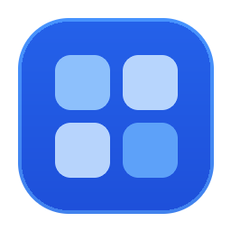
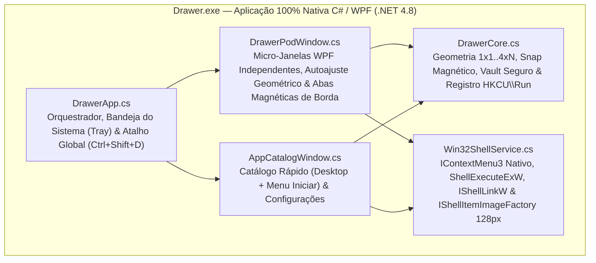

# Drawer 2.0 — Pods Nativos & Bordas Magnéticas para Windows

<p align="center">
  
</p>


[](https://renan-xavier.vercel.app)

**Autor:** Renan Santa Rosa Xavier | 🌐 **Portfólio:** [renan-xavier.vercel.app](https://renan-xavier.vercel.app)

---

## 📌 Visão Geral

O **Drawer 2.0** é um organizador nativo para Windows que agrupa programas, jogos e atalhos em **Gavetas inteligentes (Pods Nativos)** inspiradas no sistema de pastas do **Discord**.

Diferente de sobreposições de tela cheia tradicionais, cada gaveta no **Drawer 2.0** é uma **micro-janela nativa independente em C# / WPF acelerada por DirectX** (`WindowStyle.None`, zero barra superior, 0% de uso de CPU em repouso), integrada diretamente às APIs COM da Shell do Windows (`IContextMenu3`, `IShellLinkW`, `IShellItemImageFactory` e `ShellExecuteExW`).

---

## ✨ Principais Inovações da Versão 2.0

* **Pods Nativos Independentes (Zero Sobreposição de Tela Cheia):** Cada gaveta ocupa apenas seus próprios pixels na tela — sem janela invisível cobrindo o monitor, sem barra superior fantasma e sem loops de *hit-test*.
* **Encaixe Magnético nas Bordas (*Edge-Docked Tabs*):**
  * No centro da tela, o Pod vive na camada da Área de Trabalho (não cobre suas janelas abertas).
  * Ao arrastar um Pod até qualquer borda do monitor (**Esquerda**, **Direita** ou **Superior**), ele se acopla magneticamente como uma **Aba Retrátil estilo Discord** sempre acessível — basta encostar o mouse na borda da tela para abrir a gaveta por cima de qualquer jogo ou navegador maximizado.
* **Atalho Global de Chamada Rápida (`Ctrl + Shift + D` — *Peek Mode*):** Traz todas as suas gavetas instantaneamente para a frente da janela atual para abrir qualquer programa sem precisar minimizar nada.
* **Menu de Botão Direito 100% Nativo do Windows (`IContextMenu`):** Clicar com o botão direito em qualquer ícone dentro da gaveta abre o **menu real do Windows Explorer** daquele programa (*Abrir*, *Executar como administrador*, *Abrir local do arquivo*, *Propriedades*, etc.) integrado às ações da gaveta (*Renomear*, *Devolver para a Área de Trabalho*).
* **Execução 100% Fiel de Qualquer Atalho ou Programa (`.lnk`, `.url`, `.exe`, Pastas):** Preserva argumentos de inicialização (como Discord/Spotify `Update.exe --processStart`), diretório de trabalho (`WorkingDirectory`) e protocolos de jogos (`steam://rungameid/...`).
* **Catálogo Rápido de Aplicativos (1 Clique):** Escaneia automaticamente todos os atalhos da **Área de Trabalho** e programas instalados no **Menu Iniciar** com busca em tempo real para adicionar às gavetas sem precisar procurar executáveis em pastas ocultas.
* **Inicialização Real com o Windows:** Registro direto e validado em `HKCU\Software\Microsoft\Windows\CurrentVersion\Run`.

---

## 🏛️ Arquitetura da Solução



---

## 🚀 Como Compilar, Testar e Executar

```bash
# 1. Compilar o aplicativo nativo (dist/Drawer.exe) e o instalador (dist/Drawer-Setup-2.0.0.exe)
npm run dist

# 2. Executar a suíte completa de testes automatizados (Node.js + Self-Test & Smoke-Test Nativo C#/WPF)
npm test

# 3. Iniciar o Drawer 2.0 Nativo
npm start

# 4. Instalar/atualizar silenciosamente no Windows (%LOCALAPPDATA%\Programs\Drawer\Drawer.exe)
npm run install:local
```
