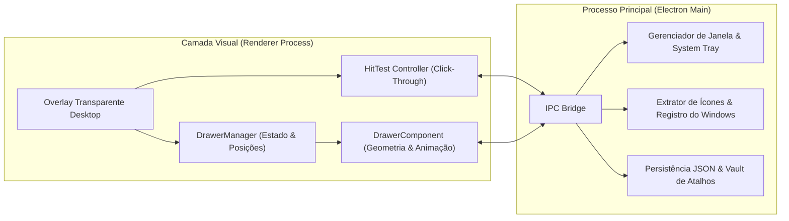

# Especificação de Design — Drawer (Organizador de Ícones para Windows)

**Data:** 2026-10-28  
**Projeto:** Drawer  
**Plataforma:** Windows 10 / Windows 11 (Desktop Application + Instalador `.exe` NSIS)  
**Stack Tecnológica:** Electron + HTML5/CSS3 (GPU-Accelerated Transitions) + Node.js (Win32 Registry & Shell Integration) + `electron-builder`

---

## 1. Visão Geral e Objetivo

O **Drawer** é um organizador de ícones para a área de trabalho do Windows inspirado nos grupos/pastas de servidores do **Discord**. Cada agrupamento é chamado de **Gaveta** (*Drawer*).

Ao contrário das pastas amarelas tradicionais do Windows Explorer, cada gaveta no Drawer é uma figura geométrica moderna — um **quadrado de pontas arredondadas na cor azul** — que exibe uma prévia dos ícones internos e possui um nome editável para classificação. Ao passar o mouse ou clicar, a gaveta desliza suavemente para o lado permitido da tela (direita, baixo ou esquerda), expandindo-se como um **retângulo/quadrado geométrico contínuo de pontas arredondadas** (como uma gaveta abrindo), cujo tamanho se autoajusta exatamente à quantidade e escala dos ícones contidos nela.

---

## 2. Requisitos Funcionais e Visuais

### 2.1. Visual da Gaveta (Fechada e Aberta)
- **Cor e Estilo:** Tons de azul moderno (ex.: `#2563EB` / `#1D4ED8` com fundo translúcido escuro-azulado `rgba(30, 58, 138, 0.88)` e borda sutil azul-clara `rgba(96, 165, 250, 0.45)`), diferenciando-se completamente da pasta amarela do Windows Explorer.
- **Geometria (Estilo Discord):**
  - **Fechada:** Um quadrado com cantos arredondados (`border-radius` proporcional ao tamanho do ícone, ex.: `16px`) exibindo uma mini-grade `2×2` com miniaturas dos primeiros 4 ícones guardados.
  - **Aberta:** Permanece uma figura geométrica limpa (quadrado/retângulo de pontas arredondadas) conectada ao corpo da gaveta, como uma gaveta deslizando para fora.
- **Autoajuste Geométrico à Quantidade de Ícones:**
  - O container aberto mantém sempre o formato de um **quadrado/retângulo geométrico de pontas arredondadas** (inspirado nos grupos do Discord), calculando suas colunas e linhas de forma exata para a quantidade `N` de ícones (até 4 ícones por faixa antes de abrir nova linha/coluna):
    - `0 ícones`: `1 × 1` (slot compacto indicando *"Solte ícones aqui"*).
    - `1 ícone`: `1 × 1` (quadrado arredondado para 1 ícone).
    - `2 ícones`: `2 × 1` na horizontal (`1 × 2` quando abre para baixo).
    - `3 ícones`: `3 × 1` na horizontal (`1 × 3` quando abre para baixo).
    - `4 ícones`: `4 × 1` na horizontal (`1 × 4` quando abre para baixo).
    - `5+ ícones`: `cols = 4` e `rows = ceil(N / 4)` na abertura horizontal (ou `rows = 4` e `cols = ceil(N / 4)` na abertura vertical), formando um retângulo geométrico perfeitamente ajustado aos ícones.
  - Ao adicionar ou remover ícones, as dimensões (`width` e `height`) do retângulo animam suavemente para o novo tamanho exato.

### 2.2. Nomeação e Classificação das Gavetas
- Cada gaveta possui um rótulo de texto centralizado logo abaixo do quadrado principal.
- O usuário pode dar qualquer nome à gaveta (ex.: *"Jogos"*, *"Trabalho"*, *"Faculdade"*, *"Utilitários"*) para classificá-las:
  - Duplo clique no nome da gaveta ou opção **"Renomear Gaveta"** no menu de contexto (botão direito) ativa a edição inline imediata.

### 2.3. Sincronização com o Tamanho dos Ícones do Windows
- As gavetas e os ícones dentro delas respeitam as 3 escalas padrão da Área de Trabalho do Windows:
  - **Pequeno (Small):** Ícones de `32px`, gaveta fechada de `48×48px`.
  - **Médio (Medium):** Ícones de `48px`, gaveta fechada de `64×64px`.
  - **Grande (Large):** Ícones de `64px` (escala grande Windows), gaveta fechada de `88×88px`.
- O aplicativo lê automaticamente o valor `IconSize` no Registro do Windows (`HKCU\Software\Microsoft\Windows\Shell\Bags\1\Desktop`) na inicialização e também permite ao usuário escolher/sobrescrever entre *Sincronizar com o Windows*, *Pequeno*, *Médio* ou *Grande* pelo menu.

### 2.4. Direção Inteligente de Abertura
- Ao abrir uma gaveta na posição `(x, y)` da tela (com dimensões de tela `screenW × screenH` e dimensões da gaveta aberta `openW × openH`), a direção de abertura é calculada automaticamente:
  1. **Preferência 1 — Direita (`right`):** Se `x + drawerSize + openW + margin <= screenW`. A gaveta se estende para a direita.
  2. **Preferência 2 — Baixo (`down`):** Se estiver próxima à borda direita ou se a preferência lateral não couber, e `y + drawerSize + openH + margin <= screenH` (ou quando configurada próxima ao topo).
  3. **Preferência 3 — Esquerda (`left`):** Se estiver no lado direito da tela (`x + drawerSize + openW + margin > screenW`), abre estendendo-se para a esquerda (`x - openW >= margin`).
  - *Regra explícita do usuário:* Se a gaveta estiver na esquerda da tela, reconhece sua posição e abre para a **direita** (ou para **baixo**, caso o usuário prefira/não haja espaço lateral). O usuário também pode definir no menu de contexto da gaveta se prefere **Automático (Padrão)**, **Direita**, **Baixo** ou **Esquerda**, sempre respeitando o limite da tela para nunca cortar fora do monitor.

### 2.5. Animação e Comportamento de Interação (Hover vs. Clique)
- **Fade e Movimento Suaves:**
  - Transição combinada de largura/altura (`width`/`height`), deslize (`transform: translate3d / scale`) e opacidade (`opacity`) com duração de **260ms** e curva `cubic-bezier(0.22, 1, 0.36, 1)`.
  - Nunca ocorre corte seco ou movimento bruto, tanto na abertura quanto no fechamento.
- **Hover (Passar o Mouse):**
  - Ao passar o mouse sobre a gaveta fechada, ela abre imediatamente com a animação suave.
  - Quando o mouse sai da área da gaveta + área aberta, inicia um temporizador de **1,25 segundo** (`1250ms`, dentro do intervalo solicitado de 1,0s a 1,5s).
  - Se o mouse retornar à gaveta antes de `1250ms`, o temporizador é cancelado e ela continua aberta.
  - Ao atingir `1250ms` sem o mouse sobre ela (e se não estiver fixada por clique), ela fecha suavemente.
- **Clique (Fixar / Fechar):**
  - **1º Clique no botão da gaveta:** Alterna para o estado **Fixado (`pinned = true`)**. A gaveta permanece aberta permanentemente, mesmo tirando o mouse de cima. Um indicador visual sutil na borda/ícone mostra que ela está fixada.
  - **2º Clique no botão da gaveta (quando aberta/fixada):** Desativa o estado fixado (`pinned = false`) e fecha a gaveta suavemente.

### 2.6. Arrastar e Soltar (Drag & Drop) de Ícones
- O usuário pode arrastar qualquer arquivo, atalho (`.lnk`, `.url`), executável (`.exe`) ou pasta da Área de Trabalho ou do Explorer e soltar diretamente sobre uma gaveta (fechada ou aberta).
- Ao soltar:
  1. O Drawer extrai o ícone nativo em alta qualidade via API do Windows/Electron (`app.getFileIcon`).
  2. Se o arquivo veio da Área de Trabalho do usuário e a opção *"Mover da Área de Trabalho ao guardar na gaveta"* estiver ativa (padrão configurável), o arquivo original é movido para a pasta segura da gaveta (`%APPDATA%\Drawer\Vault\<drawerId>\`) para liberar espaço real na Área de Trabalho; quando o usuário remove o ícone da gaveta ou arrasta de volta para fora, o arquivo é restaurado intacto para a Área de Trabalho.
  3. O retângulo da gaveta recalcula sua geometria imediatamente e se ajusta suavemente ao novo ícone.
- Os ícones dentro da gaveta também podem ter seus nomes editados, ser reordenados ou removidos via menu de botão direito, e abrem normalmente ao clicar.

---

## 3. Arquitetura do Sistema

### Componentes e Responsabilidades
1. **`src/main/main.js` (Processo Principal):**
   - Cria a janela `BrowserWindow` transparente, sem bordas (`frame: false`, `transparent: true`, `skipTaskbar: true`), ocupando a área de trabalho (`workArea`).
   - Gerencia o ícone na Bandeja do Sistema (*System Tray*) com menu rápido (*Nova Gaveta*, *Tamanho dos Ícones*, *Iniciar com o Windows*, *Sair*).
   - Expõe canais IPC para abrir arquivos/atalhos (`shell.openPath`), ler o tamanho de ícones do Registro do Windows, extrair ícones nativos (`app.getFileIcon`) e persistir o estado em `%APPDATA%/Drawer/drawers-state.json`.
2. **`src/main/preload.js` (Ponte Segura):**
   - Expõe a API `window.drawerAPI` via `contextBridge` para comunicação segura entre a interface e o sistema operacional.
3. **`src/renderer/geometry.js` (Motor Geométrico e Direcional — Testável Unitariamente):**
   - Calcula a direção de abertura (`right`, `left`, `down`) com base nas coordenadas da gaveta e nos limites do monitor.
   - Calcula as dimensões exatas `(cols, rows, width, height)` do retângulo da gaveta conforme a quantidade de ícones `N` e a escala de tamanho (`small`, `medium`, `large`).
   - Gerencia a máquina de estados de abertura/fechamento (`closed`, `hover-open`, `hover-closing`, `pinned`) e o timer de `1250ms`.
4. **`src/renderer/app.js` & `styles.css` (Interface e Interação):**
   - Renderiza as gavetas azuis arredondadas, a prévia 2×2 estilo Discord, o container geométrico expansível com animação `cubic-bezier(0.22, 1, 0.36, 1)` de `260ms`, suporte a arrastar gavetas pela tela, edição de nome e *Drag & Drop* de arquivos.
   - Controla o *Click-Through* dinâmico (`setIgnoreMouseEvents`), ativando cliques apenas quando o cursor está sobre uma gaveta, menu de contexto ou modal.

---

## 4. Tratamento de Erros e Casos de Borda

- **Atalho ou Arquivo Movido/Inexistente:** Se um atalho apontar para um caminho removido fora do Drawer, exibe um aviso amigável ao clicar e oferece a opção de remover o item da gaveta.
- **Desinstalação Segura / Exclusão de Gaveta:** Se uma gaveta contiver arquivos movidos da Área de Trabalho no *Vault*, excluir a gaveta restaura automaticamente todos os atalhos de volta para a Área de Trabalho do usuário para que nenhum arquivo seja perdido.
- **Limites da Tela (Redimensionamento de Monitor):** Se a resolução mudar e uma gaveta ficar fora da área visível, suas coordenadas `(x, y)` são ajustadas automaticamente para dentro dos limites do monitor.

---

## 5. Estratégia de Testes e Empacotamento (Instalador)

- **Testes Automatizados (`node:test`):**
  - Testes unitários para o motor geométrico (`geometry.test.js`): cálculo de dimensões exatas para `0, 1, 2, 3, 4, 5, 8` ícones nas escalas *Pequeno*, *Médio* e *Grande*; detecção de direção de abertura nos 4 cantos da tela; máquina de estados de *hover* (com delay de `1250ms`) vs. *clique* (fixação/desafixação).
- **Instalador Windows (`electron-builder` NSIS):**
  - Configuração de build para gerar o instalador executável **`Drawer-Setup-1.0.0.exe`** na pasta `dist/`, permitindo escolher pasta de instalação, criar atalho na Área de Trabalho e no Menu Iniciar, e desinstalador padrão do Windows.
