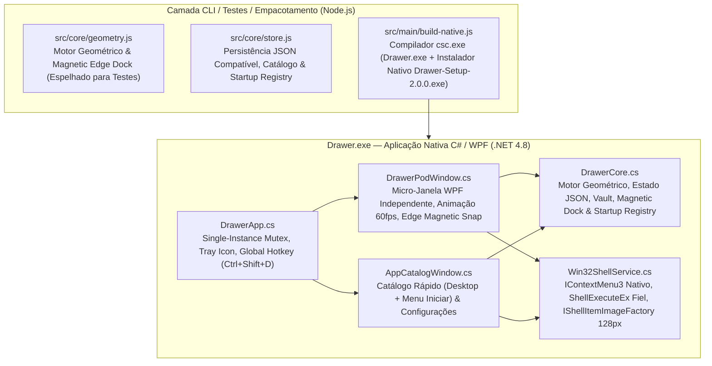

# Especificação de Design — Drawer 2.0 (Pods Nativos & Bordas Magnéticas para Windows)

**Data:** 2026-11-20  
**Projeto:** Drawer 2.0  
**Plataforma:** Windows 10 / Windows 11 (Aplicação Desktop 100% Nativa + Instalador `.exe`)  
**Stack Tecnológica:** C# (.NET Framework 4.8 / WPF DirectX Hardware-Accelerated UI + Win32 Shell COM `IContextMenu` / `IShellLinkW` / `IShellItemImageFactory` + Node.js Test & Build CLI)

---

## 1. Visão Geral e Motivação da Mudança Arquitetural

O **Drawer 2.0** evolui a idealização original do projeto — organizar atalhos, programas e jogos do Windows em **Gavetas inteligentes** inspiradas nas pastas de servidores do **Discord** — substituindo completamente a arquitetura anterior de "sobreposição Electron em tela cheia" por uma arquitetura **100% Nativa Windows (C# / WPF + Win32 Shell COM)** baseada em **Pods Nativos Independentes com Encaixe Magnético de Borda e Chamada Rápida Global**.

### 1.1. Problemas Eliminados da Versão 1.0 (Electron Overlay)
1. **Eliminação definitiva da barra superior fantasma:** A v1 usava uma janela Chromium/Electron transparente cobrindo toda a tela (`workArea`) e alterava `GWL_STYLE` via processo externo, fazendo o DWM do Windows renderizar uma barra branca não-cliente no topo. Na v2, não existe janela em tela cheia nem Chromium: cada gaveta é uma micro-janela WPF nativa independente (`WindowStyle.None`, `AllowsTransparency = true`, `WS_EX_TOOLWINDOW | WS_EX_NOACTIVATE`) que ocupa apenas os pixels da própria gaveta.
2. **Eliminação de travamentos ao abrir gavetas:** A v1 executava um loop de `35ms` no Node.js para hit-testing (`setIgnoreMouseEvents`) e outro loop de `80ms` brigando com o Z-order. Na v2, o próprio kernel/DWM do Windows entrega eventos de mouse nativamente para cada Pod apenas na sua área real, com animações a 60/120 FPS aceleradas por GPU e 0% de uso de CPU em repouso.
3. **Menu de Botão Direito 100% Nativo do Windows (`IContextMenu`):** Clicar com o botão direito em qualquer ícone dentro da gaveta invoca o menu real do Windows Explorer daquele programa/atalho via COM (`SHParseDisplayName` -> `SHBindToParent` -> `IShellFolder::GetUIObjectOf(IID_IContextMenu)` + `TrackPopupMenuEx`), com as ações exclusivas do Drawer (*Abrir*, *Renomear na Gaveta*, *Devolver para a Área de Trabalho*) injetadas no topo do menu nativo.
4. **Execução 100% Fiel de Qualquer Atalho ou Programa (`.lnk`, `.url`, `.exe`, Pastas):** Seletores de arquivos usam `DereferenceLinks = false` para nunca substituir um `.lnk` (ex.: Discord `Update.exe --processStart Discord.exe`, jogos da Steam, apps com `WorkingDirectory` específico) por um `.exe` incorreto. A execução utiliza `ShellExecuteExW` (`SEE_MASK_INVOKEIDLIST`) preservando argumentos, diretório de trabalho e variáveis de ambiente. Além disso, o **Catálogo Rápido** permite adicionar programas da Área de Trabalho e do Menu Iniciar com 1 clique.
5. **Inicialização Real com o Windows:** Registro direto e validado na chave `HKCU\Software\Microsoft\Windows\CurrentVersion\Run` apontando para o executável nativo instalado (`Drawer.exe`).

---

## 2. Requisitos Funcionais e Inovação de Experiência

### 2.1. Pods Nativos Independentes e 3 Modos de Presença
Cada gaveta é um **Pod Nativo** independente que opera automaticamente em três modos:

1. **Modo Área de Trabalho (`Desktop` — Padrão no interior da tela):**
   - Quando posicionado a mais de `18px` das bordas do monitor, o Pod fica ancorado na camada da Área de Trabalho (abaixo das janelas normais de aplicativos e imune ao comando `Win + D` / *Mostrar área de trabalho*).
2. **Modo Aba Magnética de Borda (`EdgeDocked` — Inovação):**
   - Ao arrastar qualquer gaveta até `<= 18px` da borda **Esquerda (`left`)**, **Direita (`right`)** ou **Superior (`top`)** do monitor, o Pod encaixa magneticamente na borda (`dockedEdge: 'left' | 'right' | 'top'`).
   - Quando fechada no modo acoplado, a gaveta pode recolher-se discretamente na borda como uma **Aba/Pílula Magnética estilo Discord** com `Topmost = true`, permanecendo acessível **mesmo com navegadores, IDEs ou jogos em janela maximizada**.
   - Basta encostar o cursor na aba da borda para o Pod deslizar suavemente para dentro da tela por cima do aplicativo ativo.
3. **Modo Chamada Rápida (*Peek Mode* via Atalho Global `Alt + Espaço` ou `Ctrl + Shift + D`):**
   - Pressionar o atalho global registrado via `RegisterHotKey` (`Ctrl + Shift + D`) alterna todas as gavetas para a frente de todas as janelas abertas (*Peek Overlay Mode*), permitindo abrir qualquer programa sem minimizar a janela atual.
   - Ao abrir um aplicativo ou pressionar `Esc` / repetir o atalho, os Pods de Desktop retornam suavemente para a camada da Área de Trabalho.

### 2.2. Visual Estilo Discord e Autoajuste Geométrico
- **Identidade Visual:**
  - **Fechada:** Quadrado com cantos arredondados (`border-radius` proporcional à escala) em Azul Moderno Translúcido (`#1E3A8A` com gradiente `#2563EB`, borda `#60A5FA`) ou Transparente Minimalista, exibindo a mini-grade `2×2` com os 4 primeiros ícones em alta resolução, indicador de *Pin* / *Borda Magnética* e rótulo editável logo abaixo.
  - **Aberta:** O painel geométrico arredondado se estende continuamente a partir da gaveta na direção inteligente calculada (`right`, `down` ou `left`).
- **Regra de Autoajuste Geométrico (`N` ícones):**
  - `0 ícones`: `1 × 1` (slot compacto `"+ Adicionar"` que abre o Catálogo Rápido ou aceita Drag & Drop).
  - `1 ícone`: `1 × 1`.
  - `2 ícones`: `2 × 1` (horizontal) ou `1 × 2` (vertical).
  - `3 ícones`: `3 × 1` (horizontal) ou `1 × 3` (vertical).
  - `4 ícones`: `4 × 1` (horizontal) ou `1 × 4` (vertical).
  - `5+ ícones`: `cols = 4, rows = ceil(N / 4)` na abertura horizontal (`rows = 4, cols = ceil(N / 4)` na abertura vertical).
- **Escalas Sincronizadas com o Windows (`HKCU\Software\Microsoft\Windows\Shell\Bags\1\Desktop` -> `IconSize`):**
  - `small` (`<= 36`): ícone `32px`, gaveta fechada `48×48px`.
  - `medium` (`37..56`): ícone `48px`, gaveta fechada `64×64px`.
  - `large` (`> 56`): ícone `64px`, gaveta fechada `88×88px`.

### 2.3. Comportamento de Hover (1,25s) e Clique (Pin)
- **Hover:** Passar o mouse sobre o Pod abre o painel imediatamente com transição suave (`260ms CubicEase`). Ao retirar o mouse de toda a área do Pod (cabeça + painel aberto), inicia um timer de **`1250ms`**. Se o cursor voltar antes de `1250ms`, o fechamento é cancelado; caso contrário (e se não estiver fixado), o painel recolhe suavemente.
- **Pin (Clique):** Um clique simples sem arrastar no cabeçalho da gaveta alterna o estado `isPinned`. Quando fixada (`isPinned = true`), permanece aberta mesmo sem o mouse até o próximo clique no cabeçalho.

### 2.4. Motor Win32 Shell: Menu Nativo, Execução Fiel, Catálogo Rápido e Vault
1. **Menu de Contexto Real do Windows (`IContextMenu`):**
   - Botão direito em qualquer ícone dentro da gaveta abre o menu de contexto nativo do Windows Explorer para o arquivo real (`targetPath`), precedido no topo pelos itens nativos do Drawer:
     - `Abrir "<Nome>"`
     - `Renomear na Gaveta...`
     - `Devolver para a Área de Trabalho`
     - `---` (Separador seguido de todos os itens nativos do Windows: *Abrir*, *Executar como administrador*, *Abrir local do arquivo*, *Propriedades*, etc.).
2. **Execução Fiel de Programas e Atalhos (`ShellLauncher`):**
   - Atalhos `.url` (`steam://`, `com.epicgames.launcher://`, `https://`): lê a chave `URL=` e invoca `ShellExecuteExW` diretamente na URI ou no próprio arquivo `.url`.
   - Atalhos `.lnk`: preserva o arquivo `.lnk` original. Se o arquivo `.lnk` estiver no Vault, resolve via `IShellLinkW` / `ShellExecuteExW` mantendo o `WorkingDirectory` e os `Arguments` originais (como `--processStart Discord.exe`), garantindo que 100% dos programas abram exatamente como na Área de Trabalho.
   - Executáveis `.exe`, documentos e pastas: abertos com `ShellExecuteExW` e `WorkingDirectory = Path.GetDirectoryName(targetPath)`.
3. **Catálogo Rápido de Aplicativos (Área de Trabalho + Menu Iniciar):**
   - Janela nativa moderna acessível pelo botão `+` da gaveta, pelo menu de contexto da gaveta (`+ Catálogo Rápido de Apps...`) ou pelas Configurações.
   - Escaneia automaticamente os atalhos da Área de Trabalho (`User Desktop` e `Public Desktop`) e do Menu Iniciar (`%APPDATA%\Microsoft\Windows\Start Menu\Programs` e `%PROGRAMDATA%\Microsoft\Windows\Start Menu\Programs`), exibindo ícone real, nome, origem (`Área de Trabalho` ou `Menu Iniciar`) e busca instantânea para adicionar múltiplos programas com 1 clique.
4. **Drag & Drop Bidirecional e Vault Seguro:**
   - Arrastar arquivos/atalhos do Windows Explorer ou da Área de Trabalho para o Pod adiciona os itens imediatamente.
   - Se a opção *"Mover arquivo da Área de Trabalho ao guardar na gaveta"* estiver ativa e o item vier da Área de Trabalho do usuário, o arquivo é movido para `%APPDATA%\Drawer\vault\<drawerId>\` e a Área de Trabalho é atualizada via `SHChangeNotify`.
   - Arrastar um item para fora da gaveta (soltando na Área de Trabalho ou em outra gaveta) ou escolher *"Devolver para a Área de Trabalho"* move o item entre gavetas ou restaura o arquivo original intacto na Área de Trabalho.

### 2.5. Inicialização com o Windows (`StartupManager`)
- Gerencia diretamente o valor `"Drawer"` na chave de registro `HKCU\Software\Microsoft\Windows\CurrentVersion\Run`.
- Quando `launchAtStartup = true`, grava `"\"<CaminhoRealDoDrawer.exe>\" --autostart"`.
- Quando `launchAtStartup = false`, remove o valor `"Drawer"` da chave `Run`.
- Sincroniza na inicialização do app e imediatamente ao alterar a opção na Bandeja do Sistema (*System Tray*) ou na Janela de Configurações.

---

## 3. Arquitetura de Módulos e Compatibilidade

### 3.1. Estrutura de Arquivos
- `src/native/DrawerCore.cs`: Modelos de dados compatíveis com `%APPDATA%\Drawer\drawers-state.json`, cálculo geométrico (`1×1` a `4×N`), detecção de encaixe magnético de borda (`left`, `right`, `top`, `none`), gerenciamento do Vault, catálogo de atalhos (Desktop + Start Menu) e registro real de inicialização com o Windows (`HKCU\...\Run`).
- `src/native/Win32ShellService.cs`: Integração Win32 e COM completa:
  - Extração de ícones PNG 32-bit em alta resolução (`IShellItemImageFactory`, `.lnk`, `.url`, `.ico`, `.exe`).
  - Menu de Contexto Nativo do Windows (`IContextMenu` / `IContextMenu2` / `IContextMenu3`) com injeção de comandos do Drawer.
  - Abertura 100% fiel de `.lnk`, `.url`, `.exe` e pastas (`ShellExecuteExW` + resolução `IShellLinkW`).
  - Ancoragem das janelas de Desktop acima do `Progman`/`WorkerW` (`SHELLDLL_DefView`) sem jamais exibir barra de título, e suporte a `Topmost` para Abas Magnéticas de Borda e *Peek Mode*.
- `src/native/DrawerPodWindow.cs`: Micro-janela WPF para cada gaveta, com renderização vetorial DirectX, prévia `2×2`, modo Aba Magnética Retrátil na borda do monitor, Drag & Drop nativo OLE (entrada de arquivos e saída para Desktop/outra gaveta), edição inline de nome e transição suave.
- `src/native/AppCatalogWindow.cs`: Janela WPF de Configurações + **Catálogo Rápido de Aplicativos** (busca e adição com 1 clique de apps da Área de Trabalho e do Menu Iniciar).
- `src/native/DrawerApp.cs`: Ponto de entrada `Main`, suporte a flags de linha de comando (`--self-test`, `--smoke-test`, `--extract-icon`, `--verify-startup`), ícone na Bandeja do Sistema (*System Tray*), atalho global `Ctrl + Shift + D` (*Peek Mode*) e orquestração dos Pods.
- `src/native/DrawerInstaller.cs`: Instalador gráfico nativo auto-contido (`dist/Drawer-Setup-2.0.0.exe`) que encerra processos antigos da v1, instala o novo `Drawer.exe` em `%LOCALAPPDATA%\Programs\Drawer`, cria atalhos na Área de Trabalho e Menu Iniciar, configura a inicialização com o Windows e inicia o Drawer 2.0.
- `src/core/geometry.js`, `src/core/store.js`, `src/core/icon-resolver.js`: Atualizados com a lógica de encaixe magnético de bordas (`computeMagneticDock`), registro de inicialização no Windows (`setWindowsStartupRegistry`), resolução fiel de `.lnk`/`.url` e descoberta do Catálogo Rápido.

---

## 4. Tratamento de Erros e Casos de Borda

1. **Migração Transparente da v1 para v2:** O Drawer 2.0 lê o mesmo arquivo `%APPDATA%\Drawer\drawers-state.json` e a mesma pasta `%APPDATA%\Drawer\vault`, preservando todas as gavetas e atalhos já guardados pelo usuário.
2. **Desinstalação / Exclusão Segura:** Excluir uma gaveta restaura automaticamente qualquer arquivo do Vault de volta para a Área de Trabalho do usuário e notifica o Explorer via `SHChangeNotify`.
3. **Coordenadas Fora da Tela / Mudança de Resolução:** Ao iniciar ou detectar mudança de resolução, qualquer Pod fora da área visível é reposicionado dentro dos limites do monitor primário.
4. **Atalhos com Argumentos Complexos (Discord, Steam, UWP):** Se `ShellExecuteExW` no `.lnk` do Vault precisar do diretório original, o `Win32ShellService` lê `IShellLinkW::GetWorkingDirectory` e `GetArguments` ou executa via verbo padrão da Shell do Windows, nunca falhando por falta de parâmetros.

---

## 5. Estratégia de Testes e Verificação

- **Testes Unitários e de Integração (`npm test` via `node:test`):**
  - Testes do motor geométrico (`geometry.test.js`), incluindo autoajuste `1×1` até `4×N`, direções de abertura e **Encaixe Magnético nas Bordas (`computeMagneticDock`)**.
  - Testes de persistência, Vault, **Catálogo Rápido de Apps** e **Inicialização com o Windows no Registro (`HKCU\...\Run`)** (`store.test.js`).
  - Testes de integração do binário nativo compilado `Drawer.exe --self-test` (`native-engine.test.js`), validando compilação C#/WPF, extração de ícones em alta resolução, resolução fiel de `.lnk`/`.url`, registro de startup no Windows e motor de Pods Nativos.
  - Smoke test real (`Drawer.exe --smoke-test`) validando a criação das micro-janelas WPF sem erros.
